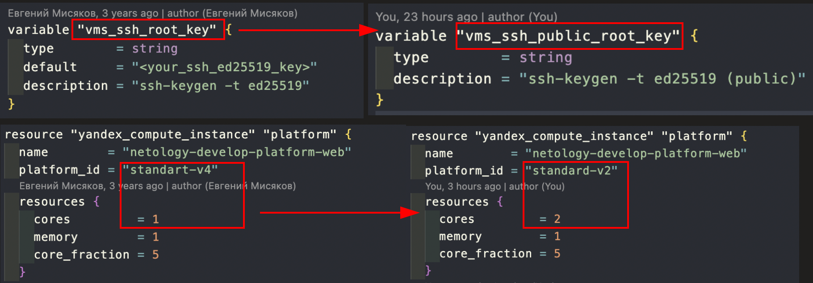
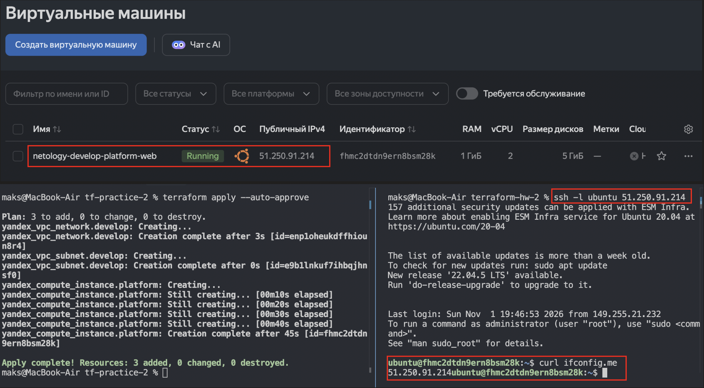
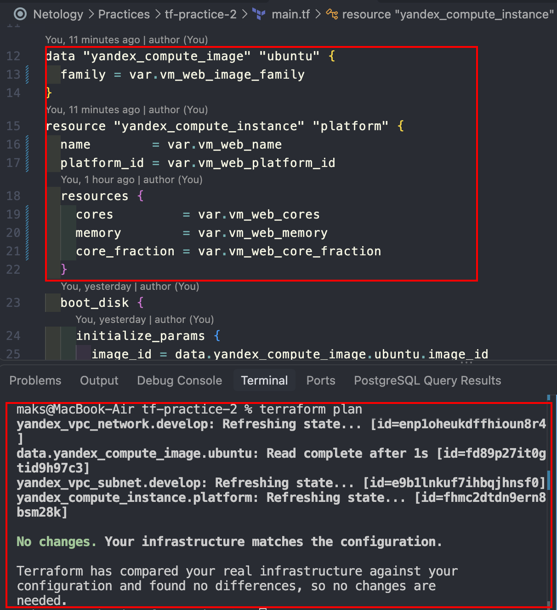
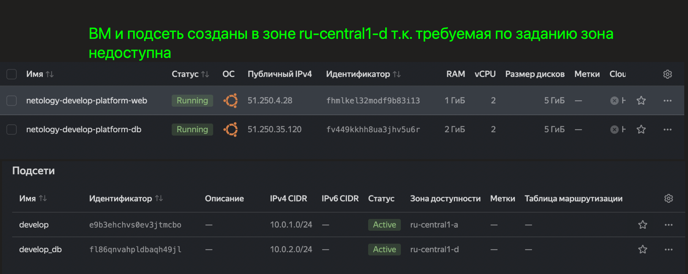
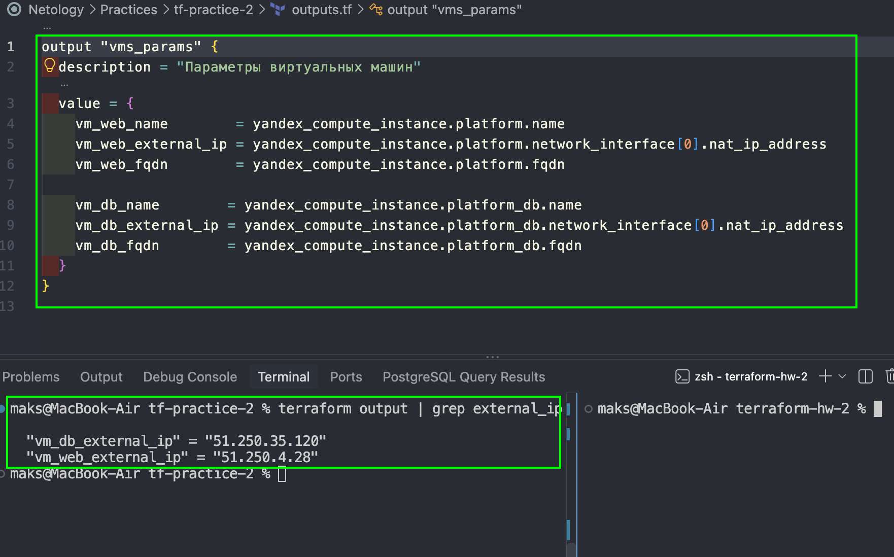
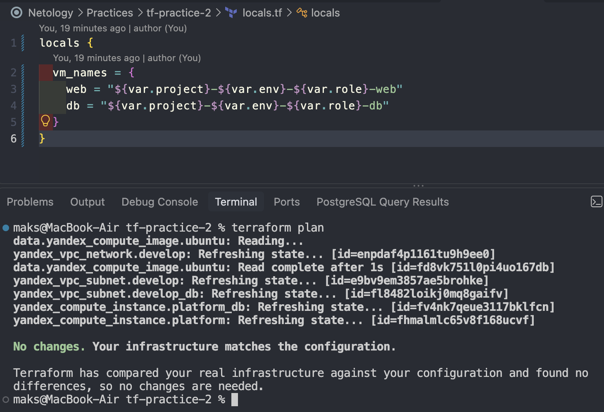

## Задание 1
#### 4.1 Для `platform_id` не существует значения `stantart-v4`, изменено на `standard-v2`.

#### 4.2 Для  `standard-v2` недопустимо `cores = 1`, изменено на `cores = 2`

#### 4.3 Неправильное название переменной `vms_ssh_root_key`, изменено на `vms_ssh_public_root_key`



#### 5 Cкриншоты ЛК Yandex и консоли.



#### 6 Ответы на вопросы:
`preemptible = true` - дешевле непрерываемой, облако может остановить её в любой момент. Данные сохраняются.
`core_fraction = 5` - минимум гарантированной мощности CPU (5%), дёшево, достаточно для учебных задач.

## Задание 2
#### Хардкод значения заменены переменными, `terraform plan` не обнаружил изменений



```hcl
# compute image & compute instance vars
variable "vm_web_image_family" {
  type = string
  default = "ubuntu-2004-lts"
  description = "yandex compute image family"
}

variable "vm_web_name" {
  type = string
  default = "netology-develop-platform-web"
  description = "virtual machine name"
}
variable "vm_web_platform_id" {
  type = string
  default = "standard-v2"
  description = "yandex platform id"
}

variable "vm_web_cores" {
  type = number
  default = 2
  description = "compute cores"
}
variable "vm_web_memory" {
  type = number
  default = 1
  description = "compute memory"
}

variable "vm_web_core_fraction" {
  type = number
  default = 5
  description = "compute core fraction (%)"
}

variable "vm_web_preemptible" {
  type = bool
  default = true
  description = "is preemptible"
}

variable "vm_web_nat" {
  type = bool
  default = true
  description = "enable NAT"
}

variable "vm_web_serial_port_enable" {
  type = number
  default = 1
  description = "is serial-port-enable: 0 or 1"
}
```

## Задание 3
#### [Ссылка на коммит](https://github.com/diasprocod5/netology-practices/commit/4b930768da9ca33d89fb55aced2624da5de70bf5)



## Задание 4
#### [Ссылка на коммит](https://github.com/diasprocod5/netology-practices/commit/df85fc303538557b958afca7555d2e7f4ab72b5a)



## Задание 5
#### [Ссылка на коммит](https://github.com/diasprocod5/netology-practices/commit/c299e3082772689760f5e93ee268353c3c6db3cb)

