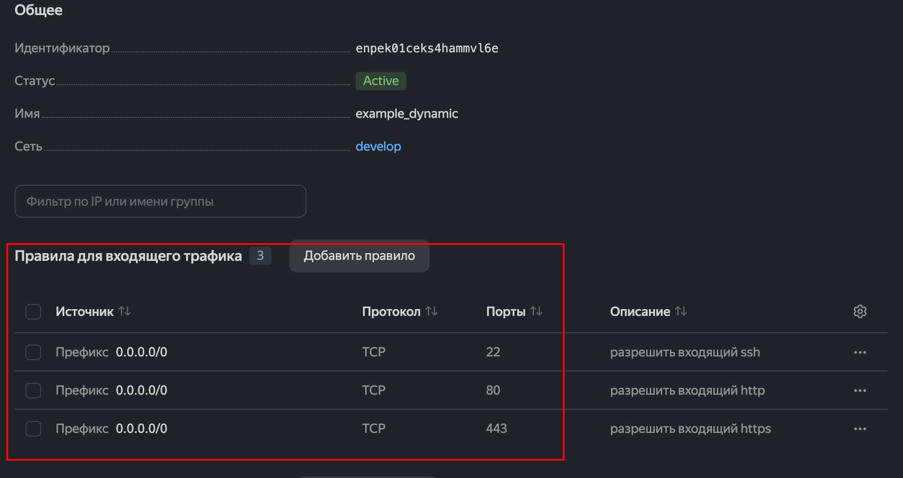
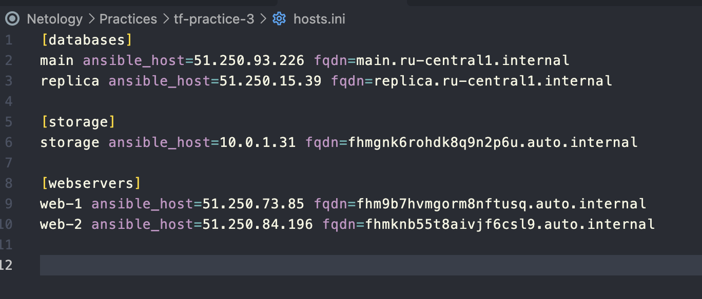

## Задание 1
#### Скриншот входящих правил политик безопасности в ЛК

## Задание 2
[Ссылка на коммит выполненного задания](https://github.com/diasprocod5/netology-practices/commit/3b8ea750c25b18b95c92ec19eb1af865a8da3408)

## Задание 3
[Ссылка на коммит выполненного задания](https://github.com/diasprocod5/netology-practices/commit/d20719c9474a898d3df99412adb3d0fd4114e1d0)

## Задание 4
[Ссылка на коммит выполненного задания в ветке terraform-03](https://github.com/diasprocod5/netology-practices/commit/0874d842834546ed54065edcf2de6596b87a5ee9)

#### Скриншот файла `hosts.ini`

